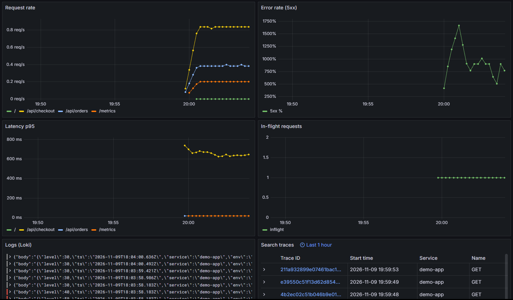
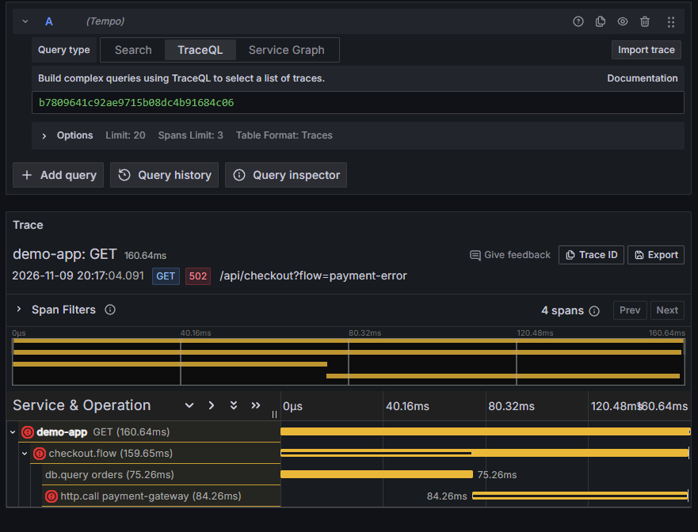
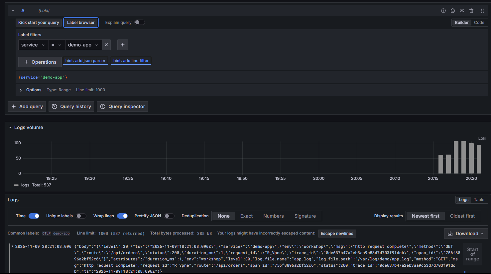

# Звіт з практичної роботи № 8

## Тема
Спостережуваність вебзастосунку за допомогою Prometheus, Grafana, Loki та Tempo.

## Мета роботи
Запустити навчальне середовище `observability-demo`, переглянути метрики, логи й трасування запитів, а також створити власний дашборд RED для сервісу `demo-app`.

## Виконання роботи

Навчальне середовище було запущено за допомогою Docker Compose. У Grafana перевірено базовий RED-дашборд: швидкість запитів, частку помилок 5xx, затримку запитів p95, логи та трасування.

У Tempo відкрито трасу запиту `GET /api/checkout?flow=payment-error`. Траса містить чотири спани, зокрема операції звернення до бази даних і платіжного сервісу. Приклад демонструє, як за trace можна побачити тривалість і послідовність операцій запиту.

У Loki виконано пошук логів сервісу за запитом `{service="demo-app"}`. У результатах відображаються структуровані логи запитів, зокрема маршрут, HTTP-статус, тривалість і `trace_id`.

Для сервісу `demo-app` створено власний дашборд **My Demo RED** із чотирма панелями:

1. **Requests per second** — швидкість запитів, згрупована за маршрутом.
2. **Error rate (5xx %)** — частка відповідей із кодом 5xx.
3. **Request latency p95** — 95-й перцентиль затримки запитів.
4. **Application logs — demo-app** — логи застосунку з Loki.

Для дашборда використовується часовий інтервал останніх 15 хвилин. Запити PromQL і LogQL та пояснення панелей наведено у файлі `practical8-defense.md` і в JSON дашборда.

## Результат
У Grafana одночасно відображаються метрики запитів, частка помилок, затримка p95 та логи застосунку. У Tempo переглянуто трасу з деталями спанів, у Loki знайдено логи `demo-app`.

## Докази виконання

### Базова частина: RED-дашборд

### Базова частина: trace у Tempo

### Базова частина: логи у Loki

### Власний дашборд My Demo RED

